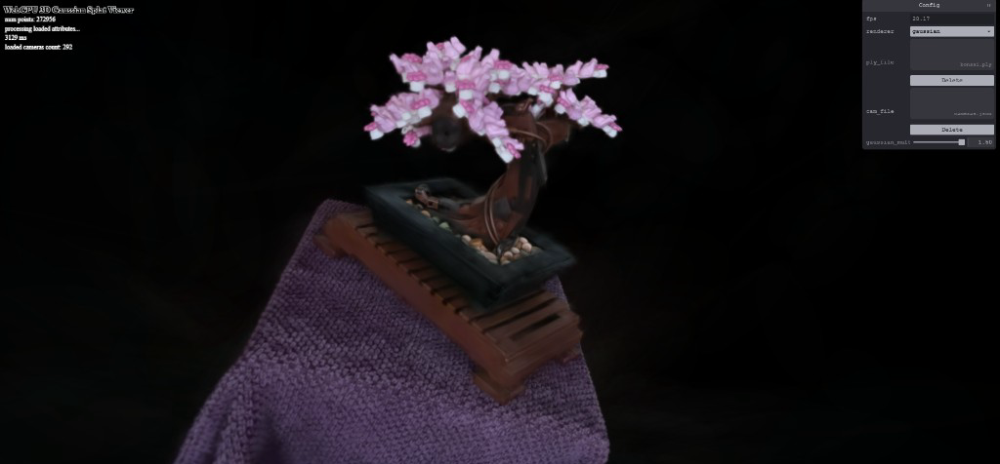

# WebGPU Gaussian Splat Viewer

**University of Pennsylvania, CIS 5650: GPU Programming and Architecture, Project 5**

- Nikita Lopatenko
- Tested on: Google Chrome 155.0.8059.84 (64-bit) on Windows 11 Pro, Intel Core i7-13620H @ 2.40GHz, 32GB RAM, NVIDIA GeForce RTX 4070 Laptop GPU 8GB (personal laptop)

## Live Demo

[WebGPU Gaussian Splat Viewer](https://nikitalopatenko.github.io/Project5-WebGPU-Gaussian-Splat-Viewer/)

The demo needs a browser that supports WebGPU. Google Chrome is recommended. To view a scene, upload its PLY file and camera JSON file using the menu in the top-right corner.

## Final Result

## Demo Video

This video shows the point-cloud renderer, Gaussian renderer, camera movement, and Gaussian size slider.

[Watch or download the 36-second demo video](images/demo.mp4)

## What This Project Does

This project displays a 3D scene in the browser using WebGPU and Gaussian splatting.

A Gaussian is basically a small soft 3D blob. A trained scene can contain hundreds of thousands or even millions of these blobs. When we put them together with the correct position, size, shape, color, and transparency, they recreate the original scene.

The PLY file is already trained, so this project does not train a machine-learning model. The goal is to load the finished data and render it efficiently on the GPU.

The project has two rendering modes:

- Point Cloud draws one small point for every Gaussian.
- Gaussian draws soft, colored, and transparent ellipses that blend together.

## Features I Implemented

- Point-cloud rendering with model-view-projection transformation
- Indirect rendering with six vertices for each Gaussian quad
- GPU preprocessing with a compute shader
- View-frustum culling to remove invisible Gaussians
- A compact list containing only the visible Gaussians
- 3D covariance calculated from rotation and scale
- 2D covariance calculated using the camera and a Jacobian matrix
- Quad size calculated from the largest eigenvalue
- GPU depth sorting from back to front
- Spherical harmonics color
- Gaussian opacity restored with a sigmoid function
- Elliptical Gaussian shape calculated in the fragment shader
- Exponential opacity falloff
- Alpha blending between overlapping Gaussians
- A slider that changes Gaussian size
- Preprocess workgroup-size testing and tuning

## How the Renderer Works

### Loading the Data

Each Gaussian stores:

- a 3D position;
- opacity;
- rotation;
- scale;
- spherical harmonics coefficients used for color.

Most of this data is stored as packed 16-bit floating-point numbers. The preprocess shader first unpacks the values so that it can use them in its calculations.

### Removing Invisible Gaussians

We first transform each Gaussian position from world space to screen space.

If a Gaussian is outside a slightly enlarged screen boundary, we stop processing it. This is called view-frustum culling. The boundary is slightly larger than the visible screen so that Gaussians near the edges do not suddenly disappear.

The visible Gaussians use an atomic counter to get unique positions inside a smaller compact list. This also tells the indirect draw call how many Gaussians need to be drawn.

### Finding the Size and Shape

The scale stored in the PLY file is in logarithmic form, so we use an exponential function to get the real scale.

The rotation is stored as a quaternion. We normalize it and turn it into a rotation matrix.

We then combine rotation and scale to calculate the 3D covariance:

`Sigma_3D = (R * S) * transpose(R * S)`

Covariance may sound complicated, but here it simply describes the size, shape, and direction of the 3D Gaussian.

Next, we use the camera and a Jacobian matrix to project this 3D shape onto the 2D screen. The result tells us the size, shape, and rotation of the ellipse that we need to draw.

We find the largest eigenvalue of the 2D covariance and use it to create a quad that covers three standard deviations of the Gaussian. This quad is only a box around the Gaussian. The fragment shader later makes the actual soft ellipse inside it.

### Sorting

Transparent objects need to be drawn from back to front. If we draw them in the wrong order, their colors and opacity combine incorrectly.

The preprocess shader stores a depth value and an index for every visible Gaussian. The provided GPU radix sorter sorts these pairs by depth.

We do not move all the Gaussian data around. Instead, we sort the indices and use them to read the Gaussians in the correct order.

### Color

The scene stores spherical harmonics coefficients instead of one fixed color per Gaussian. Spherical harmonics allow the color to change depending on the direction from the camera to the Gaussian.

The preprocess shader reads these coefficients, evaluates the provided spherical harmonics function, and stores the final RGB color for rendering.

### Final Gaussian Shape

The vertex shader creates a quad around every visible Gaussian.

For every pixel in the quad, the fragment shader measures the distance from the Gaussian center and evaluates the conic equation:

`power = -0.5 * (A*x*x + 2*B*x*y + C*y*y)`

The opacity then becomes:

`alpha = opacity * exp(power)`

The center stays more visible, while the edges smoothly fade away. We get rid of almost invisible fragments and combine the rest using source-over alpha blending.

This turns the original rectangles into soft, rotated ellipses.

## Performance Analysis

FPS means frames per second, so a larger value is better. Frame time is the number of milliseconds needed for one frame, so a smaller value is better.

I converted FPS into frame time using:

`frame time = 1000 / FPS`

For all tests, I kept the bonsai scene, camera position, window size, and Gaussian multiplier the same. I waited for the FPS to stabilize and then recorded several values.

### Point Cloud vs Gaussian Renderer

- Point Cloud: 144.18 FPS, 6.94 ms
- Gaussian: 63.21 FPS, 15.82 ms

The Point Cloud renderer was about 2.28 times faster.

This makes sense because Point Cloud only transforms and draws one point for every Gaussian. The Gaussian renderer has to do much more work. It calculates covariance, removes invisible Gaussians, finds color, sorts by depth, creates quads, calculates the soft shape, and blends transparent pixels.

You can also see that the two renderers look very different. The point cloud looks sparse and only shows the rough scene geometry. Gaussian rendering gives us smoother surfaces, view-dependent colors, transparency, and an image that looks much closer to the original scene.

### Preprocess Workgroup Size

A workgroup is a batch of GPU threads that work together. I tested several preprocess workgroup sizes:

- 32 threads: 60.71 FPS, 16.47 ms
- 64 threads: 61.97 FPS, 16.14 ms
- 128 threads: 62.75 FPS, 15.94 ms
- 256 threads: 61.75 FPS, 16.19 ms

A workgroup size of 128 gave the best result on my GPU, so I kept it in the final renderer.

The differences were small. Smaller workgroups create more groups for the GPU to schedule. Very large groups can also make it harder for the GPU to distribute its work. The rest of the renderer, especially sorting and drawing all the transparent pixels, also takes a lot of time. Because of that, changing only the preprocess workgroup size does not completely change the final performance.

### View-Frustum Culling

- Culling ON: 62.48 FPS, 16.01 ms
- Culling OFF: 39.72 FPS, 25.18 ms

Culling made the renderer about 1.57 times faster and increased the average FPS by about 57%.

Without culling, invisible Gaussians still go through covariance calculation, color calculation, sorting, and rendering. With culling, we remove them early and avoid most of that unnecessary work.

### Number of Gaussians

- 30,000 Gaussians: about 144.10 FPS or higher, 6.94 ms or less
- 100,000 Gaussians: 116.59 FPS, 8.58 ms
- 200,000 Gaussians: 76.16 FPS, 13.13 ms
- 272,956 Gaussians: 61.36 FPS, 16.30 ms

The FPS decreases when we add more Gaussians. More Gaussians mean more compute threads, sorting keys, quad vertices, and transparent pixels.

The 30,000-Gaussian test reached the approximate 144 Hz refresh limit of my monitor. The program sometimes showed around 147 FPS because it measures short time intervals that can vary slightly. The browser still cannot present more than about 144 frames per second on this display, so the real uncapped result may be higher.

The performance does not decrease in a perfectly straight line. Every frame has some fixed work, culling changes how many Gaussians stay visible, and different Gaussians cover different numbers of pixels.

## Credits

- [3D Gaussian Splatting](https://repo-sam.inria.fr/fungraph/3d-gaussian-splatting/)
- [Differential Gaussian Rasterization](https://github.com/graphdeco-inria/diff-gaussian-rasterization)
- [Vite](https://vitejs.dev/)
- [Tweakpane](https://tweakpane.github.io/docs/v3/)
- [wgpu-matrix](https://github.com/greggman/wgpu-matrix)
- Special thanks to Shrek Shao and the CIS 5650 course staff